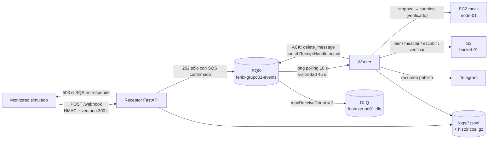

# Fénix — Sistema de autorreparación de infraestructura

Trabajo Final · Programación para Automatización II · Opción 4.3.1 · Grupo `grupo01`

Un webhook autenticado recibe una alerta de monitoreo, la guarda en SQS y un worker separado
repara el recurso emulado por Boto3 y avisa por Telegram. Dos reparaciones, chicas y verificables:
una instancia EC2 mock detenida vuelve a `running` y un bucket S3 recupera sus etiquetas
obligatorias.

---

## 1. Objetivo del sistema

La mesa de operaciones recibe alertas de un sistema de monitoreo simulado. Algunas indican que un
nodo de pruebas quedó detenido; otras, que un bucket perdió la etiqueta que reconoce a su
responsable.

El sistema cumple tres reglas de diseño:

1. **La alerta no repara dentro de la petición HTTP.** El receptor autentica, valida y publica en
   SQS. Devuelve `202` únicamente cuando SQS confirmó el mensaje.
2. **El worker trabaja por separado y consulta el estado real antes y después de cambiarlo.** No
   supone: lee la API, actúa y vuelve a leer para confirmar.
3. **Repetir el mismo evento o reiniciar el proceso no repite acciones ya verificadas.** El
   `event_id` identifica la operación de negocio y la reparación es convergente.

**Resultado mínimo verificable**: una instancia EC2 mock detenida vuelve a `running`, un bucket S3
recupera sus etiquetas sin perder las ajenas, los mensajes válidos se confirman después de reparar y
avisar, y los que fallan de forma persistente llegan a la DLQ.

## 2. Integrantes y roles

| Rol | Apellido y nombre | Correo | Módulos | Pruebas defendidas |
| --- | --- | --- | --- | --- |
| I1 — Entradas y excepciones | _(completar)_ | _(completar)_ | `utils/errors.py`, `utils/validation.py`, `services/events.py` | F06 (esquema), F07 |
| I2 — Mensajería e inventario cloud | _(completar)_ | _(completar)_ | `services/sqs.py`, `services/demo.py` | F01, F09, F10 |
| I3 — Webhooks y reparación | _(completar)_ | _(completar)_ | `utils/crypto.py`, `services/receiver.py`, `services/remediation.py` (`repair`) | F02, F03, F04, F05, F06, F07, F13 |
| I4 — Observabilidad y aviso | _(completar)_ | _(completar)_ | `utils/logging_json.py`, `services/notifications.py` | F14, F16 |
| I5 — Integración y worker | _(completar)_ | _(completar)_ | `services/worker.py`, `services/remediation.py` (`handle`), `cli.py` | F02 completo, F08, F11, F12, F15 |
| I6 — Pruebas y diagnóstico | _(completar)_ | _(completar)_ | `tests/`, `demo.inject_fault` | Matriz completa y derivación a DLQ |

_(La tabla debe completarse con apellido, nombre y correo antes de entregar: §2.1 lo exige y no se
inventan datos de integrantes.)_

Cada integrante presenta su módulo en el video, explica una decisión de diseño y demuestra un caso
correcto y uno de fallo. Ver la sección 9.

## 3. Prerrequisitos y versiones

| Elemento | Versión usada |
| --- | --- |
| Python | **3.14.4** (el proyecto declara `>=3.11`; todo el grupo usa la misma) |
| Docker | Docker Engine o Docker Desktop, con el daemon iniciado |
| LocalStack | imagen **`localstack/localstack:4`** → 4.14.0, edición community |
| Sistema | Linux, macOS o WSL |

Dependencias exactas: `requirements-lock.txt` (generado con `pip freeze`).
Dependencias declaradas: `requirements.txt` y `pyproject.toml`.

**Sobre la imagen de LocalStack.** Una etiqueta más nueva (`localstack/localstack:2026.10.0`) exige
licencia: aborta con código 55 y el mensaje *"No credentials were found in the environment. Please
set the LOCALSTACK_AUTH_TOKEN"*. La etiqueta `4` funciona en la edición community con `sqs`, `s3` y
`ec2` mock, que es todo lo que este trabajo necesita. No se usa `latest`.

No se usa AWS real ni credenciales de AWS: el helper de clientes rechaza cualquier destino que no
sea `http://localhost:4566`.

## 4. Instalación desde cero

```bash
git clone https://github.com/No-Py-No-gain/fenix.git
cd fenix
python -m venv .venv
source .venv/bin/activate            # Windows PowerShell: .venv\Scripts\Activate.ps1
python -m pip install -e .

cp .env.example .env                 # Windows: Copy-Item .env.example .env
python -c "import secrets; print(secrets.token_urlsafe(32))"   # pegar en WEBHOOK_SECRET
$EDITOR .env                          # completar las variables de la sección 5

docker compose up -d
until curl -sf http://localhost:4566/_localstack/health; do sleep 2; done
```

El `WEBHOOK_SECRET` se genera, no se obtiene de ningún servicio: es el secreto compartido entre el
emisor y el receptor. Debe tener **16 caracteres o más** (el firmador rechaza menos). No se versiona:
`.env` está en `.gitignore`.

## 5. Variables de entorno y arquitectura

### 5.1 Variables

| Variable | Obligatoria | Para qué |
| --- | --- | --- |
| `AWS_ENDPOINT_URL` | sí | Destino del emulador. Sólo se acepta `http://localhost:4566` |
| `AWS_ACCESS_KEY_ID` | sí | Credencial ficticia exigida por el SDK |
| `AWS_SECRET_ACCESS_KEY` | sí | Credencial ficticia exigida por el SDK |
| `AWS_DEFAULT_REGION` | sí | Región usada por Boto3, por ejemplo `us-east-1` |
| `QUEUE_PREFIX` | sí | Prefijo de las colas, por ejemplo `fenix-grupo01` |
| `GROUP_ID` | sí | Grupo dueño de los recursos: `grupo01` |
| `WEBHOOK_SECRET` | sí | Secreto HMAC compartido entre emisor y receptor (≥ 16 caracteres) |
| `NOTIFY_PROVIDER` | sí | `console` para desarrollo, `telegram` para la entrega |
| `TELEGRAM_BOT_TOKEN` | con `telegram` | Token del bot creado con BotFather |
| `TELEGRAM_CHAT_ID` | con `telegram` | Chat autorizado que recibe los avisos |
| `LOCALSTACK_IMAGE` | sí | Imagen que usa `compose.yaml`; debe ser una etiqueta validada, nunca `latest` |
| `LOCALSTACK_AUTH_TOKEN` | no | Sólo si la imagen elegida exige licencia |

**Ningún valor real se pega en el repositorio ni en la documentación.** Si un secreto llegó a
Git, borrarlo del último commit no lo revoca: hay que regenerarlo.

### 5.2 Arquitectura



El receptor acepta, la cola conserva y el worker decide la reparación. Los logs se emiten desde
todos los componentes; el diagrama dibuja una sola salida para no repetir flechas.

`compose.yaml` levanta el emulador con `SERVICES=sqs,s3,ec2` y `EC2_VM_MANAGER=mock`. Python corre
en el host: dentro del contenedor no hay máquina Linux real que reparar.

## 6. Contratos y ejecución

### 6.1 Contrato del evento (cerrado: todos los campos son obligatorios)

```json
{
  "schema_version": 1,
  "event_id": "evt-node-001",
  "event_type": "instance.stopped",
  "resource_id": "node-01",
  "occurred_at": "2026-10-22T18:00:00Z",
  "simulate_failures": 0
}
```

| Campo | Regla |
| --- | --- |
| `schema_version` | entero `1` |
| `event_id`, `resource_id` | `[a-z0-9-]{3,32}` |
| `event_type` | `instance.stopped` o `bucket.tags_missing`, compatible con el recurso |
| `occurred_at` | UTC explícito; describe el evento, no la firma |
| `simulate_failures` | entero de 0 a 5, nunca `bool` |

No se aceptan claves extra ni ausentes, ni un `bool` donde va un entero, ni un `resource_id` que no
pertenezca al inventario.

### 6.2 Contrato del inventario (`data/inventory.json`)

```json
{
  "node-01": {
    "type": "ec2",
    "id": "i-0123456789abcdef0",
    "group": "grupo01",
    "image_id": "ami-0123456789abcdef0",
    "security_group_id": "sg-0123456789abcdef0",
    "expected_tags": {
      "ManagedBy": "ppa2", "Project": "fenix", "GroupId": "grupo01", "Owner": "grupo01"
    }
  },
  "bucket-01": {
    "type": "s3",
    "id": "fenix-grupo01-demo",
    "group": "grupo01",
    "expected_tags": {
      "ManagedBy": "ppa2", "Project": "fenix", "GroupId": "grupo01", "Owner": "grupo01"
    }
  }
}
```

`expected_tags` es la política de estado deseado: sin ella la reparación no puede verificar nada y
falla de forma explícita en lugar de declarar éxito. **Nunca se repara un recurso externo porque
aparezca su ID en un evento**: el alias se resuelve contra este inventario.

### 6.3 Respuestas HTTP del receptor

| Situación | Respuesta | Efecto |
| --- | --- | --- |
| Firma ausente, malformada, incorrecta o fuera de ventana | `401` | No publica |
| Cuerpo mayor a 16 KiB | `413` | No publica |
| JSON roto o UTF-8 inválido con firma válida | `400` | No publica |
| JSON válido con contrato incorrecto | `422` | No publica |
| SQS no disponible después de validar | `503` | No promete aceptación |
| SQS confirmó `send_message` | `202` con `event_id` y `message_id` | El worker procesa después |
| Falta `WEBHOOK_SECRET` o `QUEUE_PREFIX` | `503` | Falla de configuración del servidor, no del emisor |

La firma es `HMAC-SHA256(secret, bytes(timestamp) + b"." + raw_body)`, viaja en
`X-Webhook-Signature: t=<epoch>,v1=<64 hex>` y se acepta dentro de ±300 segundos. Se rechazan claves
duplicadas y formatos ambiguos, y todos los rechazos comparten un mensaje genérico: el error no
sirve para adivinar el secreto ni la ventana.

La ventana **no** evita duplicados dentro de cinco minutos: de eso se ocupan el ledger y la
reparación convergente.

### 6.4 Contrato del registro (JSON por línea)

Campos base: `timestamp` (ISO 8601 UTC con offset `+00:00`), `level`, `message`, `process`, `thread`.
Campos de contexto: `event_id`, `message_id`, `resource_id`, `attempt`, `action`, `status`. Los no
aplicables se emiten como `null`, no se omiten. Los niveles `DEBUG`, `INFO`, `WARNING`, `ERROR` y
`CRITICAL` están demostrados con pruebas; un fallo normal no se eleva a `CRITICAL`.

Cada proceso escribe su propio archivo (`logs/<componente>-<pid>.jsonl`) para no rotar el mismo
archivo desde varios procesos. La rotación comprime a `.gz` de forma atómica: primero `<dest>.tmp` y
luego `os.replace`, para no dejar un comprimido truncado con apariencia válida.

No se registran tokens, secretos, firmas completas, cuerpos HTTP con datos sensibles ni URLs
privadas del canal de aviso.

### 6.5 Ejecución por terminal

Tres terminales con el entorno virtual activado y el `.env` completo:

```bash
# Preparación (una vez; ambas órdenes son idempotentes)
python -m fenix.cli init-queues      # crea la cola y su DLQ con RedrivePolicy
python -m fenix.cli setup-demo       # crea o recupera instancia, SG y bucket

# Terminal 1: receptor. --env-file hace explícita la configuración.
python -m uvicorn fenix.services.receiver:app --host 127.0.0.1 --port 8000 \
    --workers 1 --env-file .env

# Terminal 2: worker
python -m fenix.cli worker

# Terminal 3: enviar una alerta
python -m fenix.cli send examples/node-event.json
```

`send` firma exactamente los bytes que envía: no re-serializa después de firmar. Si se re-serializa,
la firma deja de corresponder y el receptor responde `401`.

**Códigos de salida de la CLI**: `0` éxito, `1` fallo controlado (se registra el tipo de error, sin
`traceback` en pantalla), `2` error de argumentos de `argparse`.

`--once` consulta una sola vez y termina aunque no haya mensajes. `Ctrl+C` detiene el proceso de
forma controlada y el `main` apaga el `QueueListener` en `finally`, sin confirmar mensajes ni
destruir recursos desde ese bloque.

**Latencia**: no se declara ninguna cifra. El receptor espera la confirmación de SQS antes de
responder `202`, y Boto3 es bloqueante, así que las llamadas al SDK y la lectura del inventario se
ejecutan con `run_in_threadpool` para no frenar el bucle de FastAPI. Se mide y se informa el tiempo
observado, no se declara éxito para cumplir una cifra.

## 7. Reintentos, DLQ e idempotencia

### 7.1 Parámetros de la cola

| Parámetro | Valor | Por qué |
| --- | --- | --- |
| Cola de trabajo | `<QUEUE_PREFIX>-events` | Cola estándar |
| Cola de mensajes fallidos | `<QUEUE_PREFIX>-dlq` | Destino de la derivación automática |
| `VisibilityTimeout` | 45 s | Ventana para una operación breve; no se espera a EC2 durante minutos |
| `RedrivePolicy.maxReceiveCount` | 3 | Al superarlo, SQS deriva el mensaje a la DLQ |
| Retención | 4 días (trabajo) / 14 días (DLQ) | Margen para diagnosticar |
| `receive_message` | 1 mensaje, long polling 10 s | Una entrega por consulta |
| Backoff | `min(30, 2 ** recepciones)` → 2, 4, 8… | Cambia la visibilidad del mensaje original |

**No se hace `send_message` nuevo al reintentar.** Copiar el mensaje a la misma cola reiniciaría su
cuenta de recepciones y la DLQ nunca se activaría. Tampoco se hace `ACK` de un mensaje venenoso para
que desaparezca: se conserva y deja actuar a la `RedrivePolicy`.

Fallas transitorias (timeout, limitación temporal, 5xx) y permanentes (esquema inválido, recurso
ajeno, credenciales rechazadas) se conservan igual: cambia la explicación del registro. En el
laboratorio, la misma DLQ automática resuelve ambas.

### 7.2 Idempotencia

- El **`event_id`** identifica la operación de negocio; el **`MessageId`** identifica el mensaje de
  SQS; el **`ReceiptHandle`** identifica la recepción actual. Se borra con el `ReceiptHandle` más
  reciente y **nunca** con el `MessageId`.
- La reparación es **convergente**: si la instancia ya está `running`, la respuesta es `already_ok`
  y no se arranca nada. `reboot` no se usa: repetir un reinicio no es convergencia.
- El ledger de `data/events.json` guarda por `event_id` el contenido asociado, `attempts`,
  `repair_done`, `repair_result`, `notified` y el estado, **antes** de continuar con el paso
  siguiente. Si el proceso cae después de reparar y antes de avisar, al reanudar sólo queda pendiente
  el aviso: ni se reinicia el nodo ni se reescriben etiquetas ya correctas.
- Un `event_id` que reaparece con contenido distinto se registra como **conflicto**: se conserva para
  la DLQ y no se altera el primer registro ni los recursos.
- **Un archivo JSON no convierte varias API en una transacción.** Si el proceso cae entre un efecto
  externo y el guardado local, puede tener que volver a consultar o repetir una acción segura. No se
  promete exactamente una vez: se promete convergencia.

## 8. Matriz de pruebas

Ejecución de la suite:

```bash
python -m pytest -q                     # 132 passed, 3 failed  (las 3 son del worker, ver 8.2)
```

«Verificado por» distingue la prueba automatizada de la evidencia de integración sobre LocalStack.

| ID | Caso y preparación | Resultado esperado | Resultado observado | Verificado por |
| --- | --- | --- | --- | --- |
| F01 | `init-queues` y `setup-demo` dos veces | Mismas colas y recursos, sin duplicados | Mismas URLs y mismos IDs en la segunda corrida | Integración |
| F02 | Nodo detenido, evento firmado válido | `202`, running verificado, ledger, aviso y ACK | `202` con `event_id` y `message_id`; el mismo `MessageId` leído de la cola | Integración (el ACK y el ledger esperan al worker) |
| F03 | Bucket sin `Owner`, con una etiqueta ajena | Tags restauradas y etiquetas ajenas preservadas | `repaired`; `Owner` restaurada y `Ajeno` intacta | Integración + `test_remediation.py` |
| F04 | Firma ausente, alterada, duplicada, falsa o de hace una hora | `401` y ningún mensaje nuevo | `401 Firma inválida` en los cinco casos | HTTP real + `test_crypto.py` |
| F05 | Mismos datos JSON con bytes distintos tras firmar | `401` por HMAC inválida | `401 Firma inválida` | HTTP real + `test_crypto.py` |
| F06 | JSON roto y UTF-8 inválido firmados; luego lista JSON firmada | `400` y `422`; sin publicación | `400` en los dos primeros, `422` en la lista | HTTP real |
| F07 | Alias ajeno, claves extra, claves ausentes, tipo incorrecto | Rechazo de esquema; ningún cambio cloud | `422 Evento inválido` en los cuatro casos | HTTP real |
| F08 | Evento directo a SQS con JSON corrupto | El worker sigue; el mensaje termina en la DLQ | Pendiente del worker (I5) | — |
| F09 | `simulate_failures=2`, ID nuevo | Backoff 2 y 4; después reparación y ACK | Pendiente del worker (I5) | — |
| F10 | Falla persistente, ID nuevo | Sin ACK; derivación automática a la DLQ | Pendiente del worker (I5) | — |
| F11 | Repetir un evento ya completo; luego reiniciar el worker | Sin nueva reparación ni aviso duplicado | Pendiente del worker (I5) | — |
| F12 | Cortar después de `repair_done` y antes de `notify` | El reinicio recupera sólo el aviso pendiente | Pendiente del worker (I5) | — |
| F13 | SQS detenido al recibir el webhook | `503`; sin aceptación falsa | `503` con `ClientError` y con `BotoCoreError` | `test_receiver.py` |
| F14 | Mock de aviso 429, timeout y luego éxito | La reparación no se repite; el aviso se reintenta | `RetryableError` con `reintentar_despues=30` acotado, sin token en el mensaje; envío real confirmado con `ok=true` | `test_notifications.py` + canal real |
| F15 | Cambiar el payload conservando `event_id` | Conflicto; no altera el ledger original ni los recursos | Pendiente de `handle` (I5) | — |
| F16 | Forzar rotación, abrir el `.gz` y parsear cada línea | JSON válido, UTC y contexto; ningún secreto | 40 líneas íntegras entre archivo activo e históricos, sin `.tmp` huérfanos | `test_logging_json.py` |

### 8.1 Evidencia del canal elegido

Se eligió **Telegram**. El bot se creó con BotFather y se obtuvo el `chat_id` autorizado enviando
`/start` y leyendo `getUpdates` (un bot no responde por sí solo). Un `chat_id` equivocado produce
`403 Forbidden: the bot can't send messages to the bot`; el adaptador registra esa descripción como
diagnóstico de configuración. **Un HTTP 200 no se acepta como prueba**: la confirmación exigida es
`ok=true` en el JSON de respuesta.

### 8.2 Estado de la entrega

`python -m pytest -q` da **132 passed, 3 failed**. Las tres fallas son
`tests/test_scenarios.py::test_duplicate_is_idempotent`, `::test_ack_is_after_success` y
`::test_redrive_with_localstack`, y corresponden al ciclo del worker (`worker.run` y
`remediation.handle`), que **todavía no está implementado**: la plantilla levanta
`NotImplementedError` a propósito. En consecuencia, F02 completo, F08, F09, F10, F11, F12 y F15 no
pueden demostrarse aún. No se declara un resultado que no se haya observado.

## 9. Limitaciones

1. **El worker no está implementado** (`worker.run`, `remediation.handle`). El receptor, la
   reparación, el aviso y la observabilidad sí. Consecuencia directa: no hay ACK, ni ledger, ni
   derivación automática a la DLQ demostrada.
2. **`fenix fault` no está implementado** (`demo.inject_fault`). Para demostrar F03 la falla se
   inyectó a mano con Boto3, quitando `Owner` al bucket; el comando de la CLI sigue pendiente.
3. **La imagen de LocalStack usada es la `4`.** Una etiqueta más nueva exige token de licencia. Si la
   cátedra entrega un token, se cambia `LOCALSTACK_IMAGE` sin tocar código.
4. **EC2 es mock.** Se evalúa la automatización por API, no la instalación de software dentro de una
   VM. No hay máquina Linux real que reparar.
5. **Un archivo JSON no es transaccional.** La idempotencia es convergente, no exactamente-una-vez.
6. **La entrega del aviso puede duplicarse** si un timeout ocurre después de que el proveedor aceptó
   el mensaje. Se documenta en lugar de ocultarse.

## 10. Limpieza del laboratorio

Detener primero los procesos (receptor y worker) y ejecutar la limpieza **sólo con IDs del
inventario**. Estos comandos se ejecutan **al finalizar la defensa**: hasta entonces el laboratorio
permanece en pie porque hace falta para la demostración.

```bash
python -c "
import json, boto3
kw = dict(endpoint_url='http://localhost:4566', region_name='us-east-1',
          aws_access_key_id='test', aws_secret_access_key='test')
inv = json.load(open('data/inventory.json'))
ec2, s3, sqs = boto3.client('ec2', **kw), boto3.client('s3', **kw), boto3.client('sqs', **kw)
nodo, bucket = inv['node-01'], inv['bucket-01']
ec2.terminate_instances(InstanceIds=[nodo['id']])
ec2.delete_security_group(GroupId=nodo['security_group_id'])
objetos = s3.list_objects_v2(Bucket=bucket['id']).get('Contents', [])
if objetos:
    s3.delete_objects(Bucket=bucket['id'], Delete={'Objects': [{'Key': o['Key']} for o in objetos]})
s3.delete_bucket(Bucket=bucket['id'])
"
```

Antes de destruir las colas, **documentar la DLQ leyendo un mensaje real sin eliminarlo**: sus
contadores son aproximados y no bastan como única evidencia. `data/inventory.json` no se borra
mientras existan recursos: es lo que permite reconocerlos. Apagar LocalStack puede perder los
recursos emulados, así que al reiniciar desde cero hay que verificar y reconciliar el manifiesto, no
dar por válidos IDs antiguos.

## 11. Video de defensa y declaración de ayuda externa

**Video**: _(completar con el enlace del video)_

| Momento | Contenido | Integrante |
| --- | --- | --- |
| _(completar)_ | Apertura: problema, alcance y decisiones generales | _(completar)_ |
| _(completar)_ | Rol I1 — entradas y excepciones | _(completar)_ |
| _(completar)_ | Rol I2 — mensajería e inventario cloud | _(completar)_ |
| _(completar)_ | Rol I3 — webhooks y reparación | _(completar)_ |
| _(completar)_ | Rol I4 — observabilidad y aviso | _(completar)_ |
| _(completar)_ | Rol I5 — integración y worker | _(completar)_ |
| _(completar)_ | Rol I6 — pruebas y diagnóstico | _(completar)_ |

**Declaración de ayuda externa e IA.** _Se permite IA como apoyo si se declara qué se utilizó, qué se
modificó y cómo se verificó (§2.2). Completar con el detalle real antes de entregar: herramienta
usada, tareas asistidas, qué se revisó o reescribió a mano y con qué prueba se validó cada parte.
Cada integrante debe poder explicar y modificar su código en vivo: el video no reemplaza la defensa
oral individual del programa._

## 12. Entregables del repositorio

```
src/fenix/            código (config/, services/, utils/, cli.py)
tests/                pruebas automatizadas
examples/             eventos de ejemplo para firmar y enviar
README.md             este documento
requirements.txt      dependencias declaradas
requirements-lock.txt dependencias efectivas (pip freeze)
pyproject.toml        metadatos, layout src/ y marcadores de pytest
compose.yaml          LocalStack con sqs, s3 y ec2 mock
.env.example          plantilla de variables, sin valores privados
.gitignore            excluye .env, .venv, data/, logs/ y docs/
```

`data/` y `logs/` son estado de ejecución y no se versionan. Las evidencias del trabajo no se
versionan: la matriz con resultado esperado y obtenido es esta sección 8.
